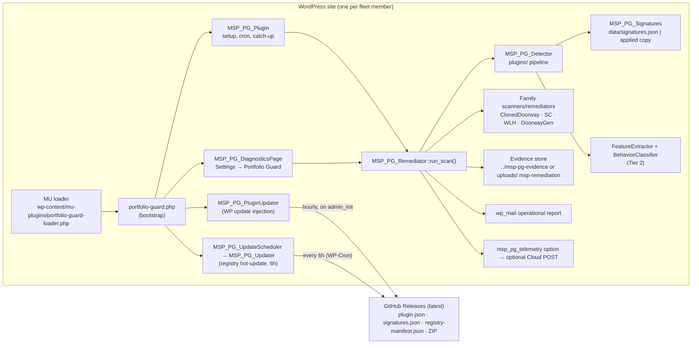

# 01 — System Architecture (Portfolio Guard 2.1.0)

> **Snapshot:** working tree of `main` on 2026-10-14. It includes 9 local commits not yet pushed and uncommitted 2.1.0 corrections. Paths are relative to the repository root. Line numbers drift, so the class or function name is the stable reference.

## A. System overview

Portfolio Guard (PG) is a WordPress plugin (`portfolio-guard/`) installed on each site in MSP's managed fleet. It runs entirely inside the site's WordPress/PHP process. There is no central server in the product: every installation scans its own filesystem, acts on its own findings, and reports by email. Fleet-level coordination happens through two GitHub release assets that every installation polls:

- a **plugin update manifest** (`plugin.json`), which the native WordPress updater uses to offer new versions;
- a **signature registry** (`signatures.json` plus an HMAC-signed `registry-manifest.json`), which installs automatically without a plugin update.

**Purpose:** detect *known* WordPress malware families by deterministic signatures (Tier 1), remove the attacker-created artifacts automatically after preserving evidence, and report behavioral suspicions for human review (Tier 2). It is not a general antivirus. Each detection path is tied to a researched malware family (see `docs/malware-families/`).



## B. Component architecture

All classes are in `portfolio-guard/includes/` and are loaded unconditionally by `portfolio-guard/portfolio-guard.php`. There is no autoloader and no Composer.

| Component | Class / file | Responsibility |
|---|---|---|
| Bootstrap | `portfolio-guard.php` | Defines `MSP_PG_VERSION`, `MSP_PG_PLUGIN_FILE`, `MSP_PG_PLUGIN_DIR`; requires all classes; registers activation, deactivation and uninstall hooks; calls `MSP_PG_DiagnosticsPage::register()`, `MSP_PG_PluginUpdater::register()`, `MSP_PG_Plugin::instance()`. |
| MU-plugin loader | `MSP_PG_Plugin::ensure_mu_loader()` / `maybe_sync_mu_loader()` | Writes `wp-content/mu-plugins/portfolio-guard-loader.php`, which `require_once`s the main plugin file by path. PG therefore loads as a must-use plugin even if it is deactivated in the plugins list. The loader is rewritten whenever the stored `msp_pg_version` differs from `MSP_PG_VERSION`, and removed on deactivate or uninstall. |
| Configuration | `MSP_PG_Config` (`class-msp-pg-config.php`) | Every tunable is a WordPress filter with a code default (table in §D). The only persisted setting is the `msp_pg_report_recipient` option; the remaining options are runtime state. Constant: `PORTFOLIO_GUARD_DRY_RUN`. |
| Scheduling | `MSP_PG_Plugin::schedule_scan()`, `next_6am_timestamp()`, `site_timezone()`, `maybe_run_catchup_scan()` | Daily WP-Cron event `msp_pg_run_scan` at 06:00 site-local time, with a single-event fallback 5 minutes out. An admin catch-up scan runs if none has run for 23 hours, and on first admin load after activation. `docs/operations/server-cron.md` covers replacing WP-Cron with a real cron job. |
| Scan orchestrator | `MSP_PG_Remediator::run_scan($trigger, $args)` | Scan lock, retention cleanup, evidence-storage resolution, the plugin-directory loop, the four additive family scanners, outstanding-component computation, the scan report, email and telemetry. This is the single entry point for every scan. |
| Detection engine (plugins/) | `MSP_PG_Detector::detect($pluginDir)` | Evaluates each `wp-content/plugins/<slug>` directory against the registry. Any exact match → Tier 1. Otherwise behavior profiles → Tier 2, or nothing. |
| Signature registry | `MSP_PG_Signatures` + `data/signatures.json` | Plugin-directory family variants (slug, main file, hashes, domains, routes, backdoor pairs, path-like IOC strings). Chooses between the bundled file and the hot-updated applied copy (§C.5). |
| Tier 2 heuristics | `MSP_PG_FeatureExtractor`, `MSP_PG_BehaviorClassifier` | Signal extraction plus five weighted profiles: persistence, command-and-control, payload-delivery, operator-access, stealth. Thresholds are in `MSP_PG_BehaviorClassifier::profile_configs()` and filterable via `msp_pg_behavior_classifier_profiles`. Report-only. |
| Family scanners | `MSP_PG_{ClonedDoorway,SC,WLH,DoorwayGen}_Scanner` + `*_Signatures` + `data/signatures-*.json` | Bounded filesystem walks for artifacts outside `plugins/` (web-root files, mu-plugins, drop-ins, wp-includes, hidden or backup directories). Each scan root is filterable (`msp_pg_*_scan_root`, default `ABSPATH`). |
| Tier 1 remediation | `MSP_PG_Remediator::remediate_detection()` (plugins/) and `MSP_PG_*_Remediator::remediate()` (families) | Evidence first, then removal or quarantine, subject to per-family flags and confidence gates (§D). |
| Tier 2 review workflow | `MSP_PG_Whitelist`, `MSP_PG_DiagnosticsPage::handle_whitelist_*`, `handle_remediate()` → `MSP_PG_Remediator::confirm_remediation()` | An operator can approve a slug and version (suppresses Tier 2 for it) or confirm it as malware. Confirmation upgrades the finding to Tier 1 for a targeted scan of that slug. |
| Evidence storage | `MSP_PG_Config::artifact_base_dir()` / `private_artifact_base_dir()` / `artifact_storage_scope()`, `MSP_PG_Utils::prepare_evidence_directory()` | Resolves the evidence root, installs deny files, and fails closed (§D). |
| Reporting & email | `MSP_PG_Remediator::write_scan_report()`, `send_scan_report()`, `scan_email_subject()`, `remediation_outcome()`; `MSP_PG_Utils::*_report()` | `report.{json,md,txt}` per scan and per artifact, plus one HTML email per non-dry-run scan to `MSP_PG_Config::report_recipient()`. |
| Telemetry | `MSP_PG_Diagnostics::record_telemetry()` → option `msp_pg_telemetry`; `MSP_PG_CloudPublisher::publish()` | Local snapshot always. `CloudPublisher` posts only if the `msp_pg_cloud_url` filter is set (unchanged); after each scan `ReportPublisher` also enrolls (once) and posts to the MSP report app unless `msp_pg_report_app_url` returns ''. |
| Plugin updates | `MSP_PG_PluginUpdater` | Injects `plugin.json` data into the `update_plugins` transient (§C.11). |
| Registry updates | `MSP_PG_UpdateScheduler`, `MSP_PG_Updater`, `MSP_PG_UpdateVerifier` | 6-hourly hot update of `signatures.json` only (§C.5). |
| Availability observations | `MSP_PG_Availability` (`class-msp-pg-availability.php`) | Daily self-originated GET to `home_url('/')`. Outcomes go to `{$wpdb->prefix}msp_pg_availability` (90-day retention). Internal retrieval API `latest()` / `between()`. Independent of scanning, remediation and email (the class references none of them); since 2.2.0 `ReportPublisher` reads the last 35 days through `between()` for the report app's payload. |
| Admin UI | `MSP_PG_DiagnosticsPage` | Settings → Portfolio Guard (`manage_options`): diagnostics, recipient, "Scan now", whitelist, confirm-remediation. All handlers check capability and nonce. |
| *(inactive)* Runtime blocking | `MSP_PG_Runtime` | **Loaded but never booted in 2.1.0.** Its only caller, `boot/mu-bootstrap.php`, was deleted in commit `ed3f9a9`. It would hide known plugins via `option_active_plugins` and 403 known backdoor requests. Older docs still describe it as active. |

There is **no WP-CLI command and no REST endpoint**. Scans start from WP-Cron, admin catch-up, or the admin "Scan now" / confirm actions (`admin-post.php?action=msp_pg_*`).

## C. Operational execution flows

**1. Install / activate** (`register_activation_hook`):
- `MSP_PG_Plugin::activate()` stores `msp_pg_pending_activation_scan` and `msp_pg_version`, then schedules the daily scan.
- `MSP_PG_UpdateScheduler::activate()` schedules `msp_pg_run_update_check` every 6 hours (`msp_pg_six_hours`), plus a one-off check 60 seconds later.

**2. Setup** (`init`, priority 1, `MSP_PG_Plugin::maybe_complete_setup()`):
- On a version change it clears and re-registers the scan schedule.
- If the MU loader is missing it writes it and schedules the scan. Failures are shown as an admin notice (`msp_pg_setup_notice`).
- The first admin page load after activation runs `run_scan('activation-catchup')`.

**3. Scheduled scans:** `msp_pg_run_scan` → `MSP_PG_Plugin::run_cron_scan()` → `run_scan('cron')`. A scan only fires when WP-Cron runs (page traffic or a server cron).

**4. Manual scans:** Settings → Portfolio Guard → *Scan now* → `handle_scan_now()` → `run_scan('manual')`. *Confirm remediation* → `confirm_remediation($slug)`, a targeted scan with `operator_confirm`. Ad hoc, a WP-CLI user can run `wp cron event run msp_pg_run_scan`; this is the core WP-CLI cron command, not a PG command.

**5. Signature loading and version selection:**
- `MSP_PG_Signatures::load()` reads the bundled `portfolio-guard/data/signatures.json` and the applied copy `wp-content/uploads/portfolio-guard/signatures.json`.
- It uses the applied copy when `applied.registry_version >= bundled.registry_version`; otherwise the bundled file.
- **Only `registry_version` (an integer) is compared.** `signature_version` (`MSP_PG_Config::signature_version()`) is a reporting label.
- The family files `data/signatures-{cloned-doorway,sc-macrocue,wp-link-helper,doorway-content-gen}.json` are loaded only from the plugin directory by their `*_Signatures` classes and are never hot-updated.

**6. Detection and classification** (`run_scan()`):
- For each `wp-content/plugins/*` directory except `portfolio-guard` and `.msp-*`, call `MSP_PG_Detector::detect()`.
- Tier 2 findings are skipped when the slug and version are whitelisted, or when the slug is in `msp_pg_trusted_plugin_slugs`. Neither rule applies to Tier 1.
- Unless the scan targets a single slug, the four family scanners run in order: ClonedDoorway, SC, WLH, DoorwayGen.

**7–9. Evidence, remediation, and manual-intervention findings:** see the sequence below and §D.

**10. Completion:**
- `outstanding_components` lists every Tier 1 finding without a completed removal; `infection_fully_resolved` is true only when that list is empty.
- The scan writes `msp_pg_state`, the scan report files (not in dry-run) and the email (not in dry-run), records telemetry (`current_security_state`, `partial_remediation`), and calls `CloudPublisher::publish()`.

**Availability observations** (`MSP_PG_Availability`, separate from flows 3–10):
- **Setup:** activation, or `maybe_install()` on `init` for upgraded sites, runs `dbDelta()` and sets option `msp_pg_availability_schema`. Then it schedules `msp_pg_availability_observation` (`daily`, first run +1 h).
- **Each run of `observe()`:** take the lock, make one `wp_remote_get(home_url('/'))` (10 s, no redirects, ≤ 4 KB read), classify, insert one row, and purge rows older than 90 days.
- **Not involved:** scans, email, telemetry.

Verified on 2026-10-14 in a disposable WordPress + MariaDB stack with a custom table prefix: the upgrade from published 2.0.9, every outcome class, the response-size limit, lifecycle, retention and retrieval.

**11. Updates and version transitions:**
- WordPress replaces `plugins/portfolio-guard/`. The activation hook does **not** run on update.
- On the next request the MU loader loads the new code. `maybe_sync_mu_loader()` (`plugins_loaded`, priority 1) rewrites the loader. Then `maybe_complete_setup()` (`init`, priority 1) sees the version change, re-registers the scan schedule, and records the new `msp_pg_version`.
  - **Only `maybe_complete_setup()` may write `msp_pg_version`.** Before the 2.1.0 fix, the loader sync recorded it first, so upgrades never rescheduled scans.
  - Guarded by `SchedulingTest::test_upgrade_reschedules_through_real_hook_order()`, which replays `plugins_loaded` then `init`.
  - Verified in real WordPress on 2026-10-14: a UTC+5:30 site upgraded from published 2.0.9 moved its scan from 06:00 UTC to 00:30 UTC.
  - Availability observations use their own schema-option check and don't depend on this path.
- Options and evidence survive the update.

```mermaid
sequenceDiagram
  participant T as Trigger (cron / admin / confirm)
  participant R as MSP_PG_Remediator::run_scan
  participant S as Detector + family scanners
  participant X as Remediators
  participant E as Evidence store
  participant O as Email / telemetry
  T->>R: run_scan(trigger, args)
  R->>R: scan lock (15 min), retention cleanup, resolve evidence root
  R->>S: detect plugins/* ; scan web root, mu-plugins, drop-ins, wp-includes
  S-->>R: analyses (tier1 / tier2)
  loop each finding
    R->>E: prepare scan dir (deny files) - on failure block all evidence writes
    R->>X: remediate(analysis, dryRun)
    X->>E: manifest + reports (+ zip / snapshot by retention mode)
    X->>X: preservation verified? confidence ok? delete flag on?
    X-->>R: actions (REMOVED / WITHHELD / REPORT_ONLY ...)
  end
  R->>R: outstanding_components, infection_fully_resolved
  R->>E: report.json/md/txt (not dry-run)
  R->>O: wp_mail (not dry-run), msp_pg_telemetry, optional Cloud POST
```

## D. Security boundaries and safeguards

✔ = verified by tests in `portfolio-guard/tests/` or `validation/`. ◐ = enforced in code but not directly tested.

| Safeguard | Implementation | Status |
|---|---|---|
| Tier 1 requires an exact match | `MSP_PG_Detector`: any of `known_plugin_directory`, `known_primary_plugin_file`, `known_filename`, `known_hash`, `known_domain`, `known_route` → Tier 1. **Name-only matches count**: a directory and main file named like a registered family is Tier 1. | ✔ `SignatureRegistryTest`, gate Known Malware |
| Removal confidence (plugins/) | `remediate_detection()`: removal only if `known_hash` or ≥2 exact-match types (`$canDeleteOriginal`). Two name-based types (directory + main file) satisfy this. | ✔ / ◐ (no test with a legitimate name collision) |
| Removal confidence (families) | SC: payload hash, ≥2 types, or verified wp-includes boundary. WLH: payload hash, IOC string or vault pattern. WLH backup directories need corroborating content. ClonedDoorway / DoorwayGen: detection itself (structural + content signatures). | ✔ family tests |
| Evidence before removal | Every remediator writes and verifies its manifest (and archive) before any delete. Failure → `Preservation verification failed`, artifact retained. | ✔ `RemediationLifecycleIntegrationTest`, `RemediationControlTest` |
| Never auto-modified | Drop-ins `advanced-cache.php`/`db.php`/`object-cache.php` (SC); modified core files such as root `index.php` (ClonedDoorway); wp-includes files without a verified content signature. Report-only with an operator instruction. | ✔ |
| Protected plugins | `msp_pg_protected_plugin_slugs` keeps **Tier 2** findings report-only. It does **not** protect against Tier 1. | ◐ |
| Symlink / containment | Symlink-safe delete, copy and zip; wp-includes boundary check; evidence-directory symlink and traversal refusal. | ✔ `*SymlinkSafetyTest`, `EvidenceStorageTest` (real symlinks on Linux only) |
| Remediation switches | `msp_pg_delete_tier1_enabled` (plugins/ deactivation **and** removal), `msp_pg_clonedoorway_delete_enabled`, `msp_pg_sc_macro_cue_delete_enabled`, `msp_pg_sc_macro_cue_wpincludes_delete_enabled`, `msp_pg_wp_link_helper_delete_enabled`, `msp_pg_doorway_content_gen_delete_enabled`. All default `true`. Off → `*_WITHHELD_DISABLED_BY_CONFIGURATION`. | ✔ `RemediationControlTest` |
| Detection-only vs dry-run | Detection-only (all flags false): full evidence, email and telemetry, no site change. Dry-run (`PORTFOLIO_GUARD_DRY_RUN`, `msp_pg_default_dry_run`, `run_scan(..., ['dry_run'=>true])`): no evidence, no email, `WOULD_*` actions. | ✔ |
| Partial-remediation reporting | `outstanding_components`, `infection_fully_resolved`, outcome subject `REMEDIATED` / `- PARTIAL REMEDIATION` / `- ACTION REQUIRED` (`remediation_outcome()`). | ✔ `RemediationControlTest`, `OperationalReportTest` |
| Evidence storage boundary | Root: `msp_pg_artifact_base_dir` → private sibling of ABSPATH (`msp_pg_private_artifact_base_dir`) → `uploads/.msp-remediation`. Deny `.htaccess`/`web.config`, `index.html`, 128-bit scan directory names. In the web root, full retention runs as zip. Insecure storage → no evidence written and no removal that scan. **nginx ignores `.htaccess`**, so the fallback needs a host rule. | ✔ `EvidenceStorageTest`; HTTP behaviour checked once in disposable nginx/Apache containers (`docs/operations/evidence-storage-and-remediation-controls.md`) |
| Scan concurrency | Transient `msp_pg_scan_lock` (15 min); catch-up lock `msp_pg_catchup_lock` (5 min). | ◐ |
| Admin actions | `manage_options` + `check_admin_referer` on every `admin_post_msp_pg_*` handler. | ◐ |

**Configuration filters** (all in `MSP_PG_Config` unless noted):

- **Remediation switches:** the six `*_delete_enabled` filters above, plus `msp_pg_default_dry_run`.
- **Evidence:** `msp_pg_evidence_retention_mode` (`metadata_only` | `compressed_archive` | `full_artifact_retention`), `msp_pg_artifact_retention_days` (7), `msp_pg_artifact_base_dir`, `msp_pg_private_artifact_base_dir`, `msp_pg_temporary_quarantine_base_dir` (system temp).
- **Scan scope:** the four `msp_pg_*_scan_root` filters, `msp_pg_max_scan_file_bytes` (2 MB), `msp_pg_scan_extensions`.
- **Classification:** `msp_pg_score_weights`, `msp_pg_protected_plugin_slugs`, `msp_pg_trusted_plugin_slugs`, `msp_pg_behavior_classifier_profiles` (classifier class).
- **Telemetry:** `msp_pg_cloud_url`, `msp_pg_cloud_api_key`.
- **Labels and intervals:** `msp_pg_signature_version`, `msp_pg_heuristic_version`, `msp_pg_plugin_update_check_interval` (1 h).

Filters are set per site by code, typically an MU-plugin. There is no fleet-wide configuration channel.

## E. Dependencies and integrations

| Dependency | Use | Notes |
|---|---|---|
| WordPress ≥ 5.0, PHP ≥ 7.4 | Runtime | 2.1.0 is tested on PHP 7.4.33, 8.3, 8.5 (CLI harness, not WordPress). |
| `ext-zip` (ZipArchive) | Evidence archives, release build/test | Without it, archive modes fail preservation and nothing is removed in those modes. |
| WP-Cron (or server cron) | Scans, registry updates | Low-traffic sites scan late without a real cron. |
| `wp_mail` | Operational email | Site's mail configuration. Default recipient is a hard-coded individual address in `MSP_PG_Config::report_recipient()` unless `msp_pg_report_recipient` is set. |
| GitHub Releases (`github.com/joshualee791/portfolio-guard`, *latest*) | `plugin.json`, `registry-manifest.json`, `signatures.json`, ZIP | URLs are hard-coded and **not filterable**: `MSP_PG_Config::plugin_update_url()`, `update_manifest_url()`. |
| HMAC key | `MSP_PG_UpdateVerifier::verify_manifest()` | Key embedded in `MSP_PG_Config::update_key()`; must equal the CI secret `MSP_PG_UPDATE_KEY`. Shipped in every plugin copy, so it gives no secrecy. |
| Portfolio Guard Cloud (legacy) | Optional telemetry POST to `{msp_pg_cloud_url}/api/telemetry` with a bearer key, via `MSP_PG_CloudPublisher` | **Off by default, unchanged.** No receiving service is in this repository. |
| MSP report app | Since 2.2.0, `MSP_PG_ReportPublisher`: `POST {msp_pg_report_app_url}/api/portfolio_guard/enroll` once (home URL in, a per-site key out, stored in `msp_pg_report_app_key`), then `POST .../api/portfolio_guard/telemetry` after each scan with that key, carrying the telemetry record plus the last 35 availability checks (wire schema 2) | **On by default**, `msp_pg_report_app_url` defaults to the report app; return '' to turn a site off. Enrollment is retried at most daily; a 401 drops the key. The receiving service is the report app's `PortfolioGuard*` code, a separate repository. |

| WordPress database (`$wpdb`) | Availability table `{prefix}msp_pg_availability` | The only custom table. Everything else PG stores in options and files. |
| Loopback HTTP to `home_url('/')` | Availability observations | Hosts or firewalls that block a site from requesting itself record `unreachable` / `connection` or `dns`. |

There are no Composer, npm or third-party PHP libraries in the plugin.
